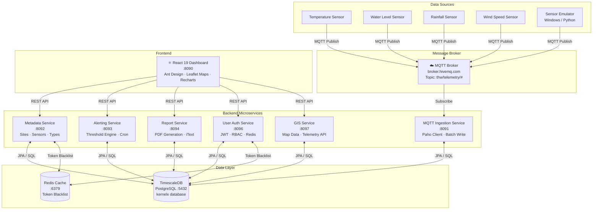
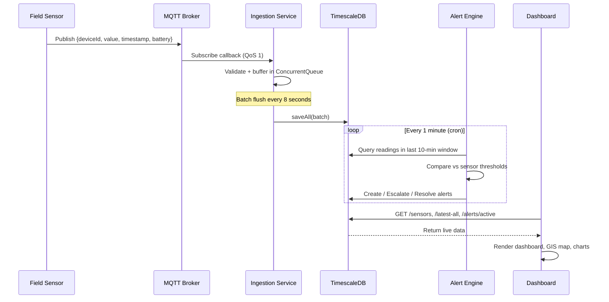
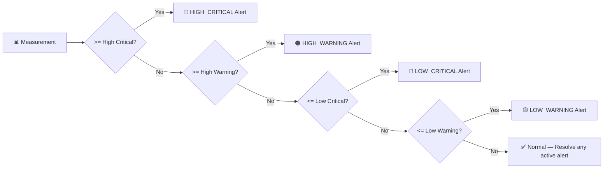

# 🌍 ATLAS – Adaptive Time-Series Analytics and Logging System
### Domain‑Agnostic Government Monitoring Platform


<p align="center">
  
</p>

<div align="center">

**A domain-agnostic, open-source telemetry monitoring platform**  
*Built for Integrated Hydro Risk Management — adaptable to any field-sensor domain*

</div>

---

**ATLAS** is a domain‑agnostic, microservices-based monitoring and management platform designed to be adapted by multiple government organizations. While the primary use case is **Integrated Hydro Risk Management**, the system is architected to support any domain requiring real-time measurements, historical analytics, and asset management.

## ✨ Core Features
  * **Real-time Alerts**: A modern, responsive interface for visualizing risk alerts and   monitoring trends.
  * **Automated Data Ingestion**: Seamless MQTT-based processing of field sensor data.
  * **Metadata Management**: Full CRUD interfaces to manage disaster-related entities and configurations.
  * **Microservices Architecture**: Decoupled backend services designed for modularity and scalability.
  * **GIS‑Based Dashboard**: Integrated mapping for spatial awareness and real-time visualization of distributed field assets.
  * **Role-Based Access & Secure Login**: Robust authentication and authorization to ensure data security across different administrative levels.
  * **Reporting Service**: Automated generation of periodic reports and data summaries for decision-makers.
  * **Analytics dashboard**: System status monitoring interactive dashboard with telemetry charts, battery status, and health scores

---

## 🏗️ System Architecture



---

## ⚡ Quick Start (5 minutes with Docker)

### Prerequisites

| Tool | Version | Install |
|------|---------|---------|
| Docker | 24+ | [Get Docker](https://docs.docker.com/get-docker/) |
| Docker Compose | 2.20+ | Included with Docker Desktop |
| Git | 2.30+ | [Get Git](https://git-scm.com/downloads) |

### 1. Clone with submodules

```bash
git clone --recurse-submodules https://github.com/cepdnaclk/e22-co2060-hydro-risk-management.git
cd e22-co2060-hydro-risk-management
```

> **Already cloned without submodules?**
> ```bash
> git submodule update --init --recursive
> ```

### 2. Configure environment

```bash
cp .env.example .env
# Edit .env with your settings (JWT secret, DB password, etc.)
```

### 3. Start all services

```bash
docker compose up --build -d
```

### 4. Open the dashboard

| Service | URL | Credentials |
|---------|-----|-------------|
| 🌐 Frontend Dashboard | http://localhost:8090 | admin / admin123 |
| 📋 Metadata API Swagger | http://localhost:8092/swagger-ui.html | — |
| 👤 Auth API Swagger | http://localhost:8096/swagger-ui.html | — |

> **First boot takes ~3–5 minutes** while TimescaleDB initializes. Services will auto-retry connections.

### 5. Send test data (optional)

Use the included sensor emulator to push test readings over MQTT:

```bash
# Python emulator (cross-platform)
cd additional-files
pip install paho-mqtt
python sensor_emulator.py --sensor-id 1001 --type water-level

# Or use the Windows Forms app: additional-files/SensorEmulator_2YP_WindowsFormsApp.zip
```

---

## 🛑 Stopping & Cleanup

```bash
# Stop all services (data preserved)
docker compose down

# Stop and remove all data volumes (fresh start)
docker compose down -v
```

---

## 🗺️ Data Flow Explained




---

## 🔧 Service Reference

| Service | Port | Tech Stack | Description |
|---------|------|-----------|-------------|
| [MQTT Ingestion](mqtt-data-ingestion-service/) | 8091 | Spring Boot 4, Eclipse Paho, TimescaleDB | Subscribes to MQTT topic, validates, buffers and batch-writes sensor telemetry |
| [Metadata Service](metadata-handling-service/) | 8092 | Spring Boot 4, PostgreSQL, Redis, Swagger | Full CRUD API for Sites, Sensors, and SensorTypes with JWT protection |
| [Alerting Service](disaster-management-alerting-service/) | 8093 | Spring Boot 4, PostgreSQL, Spring Scheduler | Cron-based engine that creates, escalates, and resolves threshold alerts |
| [Report Service](report-generating-service/) | 8094 | Spring Boot 4, iText, Thymeleaf, PostgreSQL | Generates downloadable PDF reports from historical telemetry and alert data |
| [User/Auth Service](disaster-management-user-service/) | 8096 | Spring Boot 4, JWT, Spring Security, Redis | Authentication, JWT token management, and role-based access control |
| [GIS Service](gis-monitoring-service/) | 8097 | Spring Boot 4, PostgreSQL | Read-only API serving sensor positions and telemetry for the map dashboard |
| [Frontend](disaster-management-frontend/) | 8090 | React 19, Vite, Ant Design 5, Leaflet, Recharts | Interactive monitoring dashboard with GIS map and analytics |

---

## 🚨 Alert System Explained

ATLAS supports **4 severity levels** per sensor, configurable independently:



**Each sensor defines its own thresholds** (stored in the `sensors` table):

| Field | Example (Water Level) | Meaning |
|---|---|---|
| `thresholdHighCritical` | 8.0 m | Immediate danger — flood risk |
| `thresholdHighWarning` | 6.0 m | Warning — elevated level |
| `thresholdLowWarning` | 2.0 m | Low — potential drought |
| `thresholdLowCritical` | 1.0 m | Critical — very low |

---

## 🌐 Adapting ATLAS to Your Domain

ATLAS is designed to work for **any domain with field sensors**. Here's how to adapt it:

### Step 1: Register your sensor types
```bash
POST http://localhost:8092/api/sensor-types
{
  "type": "Air Quality Sensor",
  "description": "Measures PM2.5 and CO2 levels"
}
```

### Step 2: Register your sites and sensors
```bash
POST http://localhost:8092/api/sites
{ "siteName": "City Center Station A", "location": "Colombo", "latitude": 6.9271, "longitude": 79.8612 }

POST http://localhost:8092/api/sensors
{
  "sensorId": "AQ-001",
  "siteId": 1, "sensorTypeId": 1,
  "thresholdHighCritical": 150, "thresholdHighWarning": 100,
  "thresholdLowCritical": 0, "thresholdLowWarning": 10,
  "unitOfMeasure": "µg/m³",
  "latitude": 6.9271, "longitude": 79.8612
}
```

### Step 3: Configure your MQTT topic
Edit `mqtt-data-ingestion-service/mqttSubscriber/src/main/resources/application.yml`:
```yaml
mqtt:
  broker: tcp://your-broker.com:1883
  topic: your/telemetry/topic/#   # Change this to match your device topic structure
```

### Step 4: Publish sensor data
```json
{
  "deviceId": "AQ-001",
  "value": 87.5,
  "timestamp": "2025-01-15T10:30:00Z",
  "sensorHealth": 98,
  "batteryStatus": 85
}
```

That's it — alerts, dashboards, and maps work automatically!

---

## ✨ Key Features

<table>
<tr>
<td width="50%">

### 📊 Analytics Dashboard
- System health score gauge
- Battery level distribution chart
- Reading occurrence timeline (scatter)
- Threshold status breakdown (donut chart)
- Sensor table with search, filter, and sort
- Per-sensor historical trend drawer
- Auto-refresh every 30 seconds

</td>
<td width="50%">

### 🗺️ GIS Map Dashboard
- Interactive Leaflet map (OpenStreetMap)
- Color-coded sensor markers by alert severity
- Animated pulse effect on active alerts
- Sensor search autocomplete
- Fly-to animation on sensor selection
- Detail drawer with telemetry chart

</td>
</tr>
<tr>
<td>

### 🚨 Alerting Engine
- Cron-based (every 1 minute)
- 4-level severity hierarchy
- Escalation and de-escalation
- Auto-resolution when normal
- Configurable alert retention
- Sliding time-window evaluation

</td>
<td>

### 🔐 Security
- JWT access tokens (15 min)
- Refresh tokens (1 day, HttpOnly cookie)
- Redis-backed token blacklisting
- Role-based access (ADMIN / USER)
- Auto token refresh on 401
- Seeded admin account on first boot

</td>
</tr>
</table>

---

## 🛠️ Tech Stack

### Backend
| Component | Technology |
|-----------|-----------|
| Framework | Spring Boot 4.0 |
| Language | Java 21 |
| Database | PostgreSQL 14 + TimescaleDB |
| Cache | Redis |
| Security | Spring Security + JJWT |
| MQTT Client | Eclipse Paho |
| PDF Generation | iText + Thymeleaf |
| API Docs | SpringDoc OpenAPI (Swagger) |
| Build | Maven |

### Frontend
| Component | Technology |
|-----------|-----------|
| Framework | React 19 + Vite 7 |
| Language | JavaScript + TypeScript |
| UI Library | Ant Design 5 |
| Maps | React Leaflet + Leaflet.js |
| Charts | Recharts |
| HTTP Client | Axios |
| Routing | React Router 7 |

### Infrastructure
| Component | Technology |
|-----------|-----------|
| Containerization | Docker + Docker Compose |
| Web Server | Nginx (frontend) |
| Time-series DB | TimescaleDB (PostgreSQL extension) |
| Message Broker | HiveMQ (public) / Any MQTT broker |

---

## 📚 Documentation

| Document | Description |
|----------|-------------|
| [🏗️ Architecture Guide](docs/ARCHITECTURE.md) | Detailed system design, service internals, and design decisions |
| [🚀 Deployment Guide](docs/DEPLOYMENT.md) | Docker, manual, and cloud deployment options |
| [⚙️ Configuration Reference](docs/CONFIGURATION.md) | All environment variables and config options |
| [📡 API Reference](docs/API_REFERENCE.md) | Complete REST API endpoint documentation |
| [🤝 Contributing Guide](CONTRIBUTING.md) | How to contribute, coding standards, PR process |
| [🔒 Security Policy](SECURITY.md) | Reporting vulnerabilities |

---

## 👥 Team — KernelX

| Member | ID | Contact |
|--------|----|---------|
| Dinith Kariyawasam | E/22/182 | e22182@eng.pdn.ac.lk |
| Rameesha Prathapasinghe | E/22/291 | e22291@eng.pdn.ac.lk |
| Tharindu Weerasinghe | E/22/421 | e22421@eng.pdn.ac.lk |
| Gayumi Wimalaweera | E/22/449 | e22449@eng.pdn.ac.lk |

**Supervised by:** Prof. Kamalanath Samarakoon  
**Module:** CO2060 Software Systems Design  
**Department of Computer Engineering, University of Peradeniya**


---

<div align="center">

**⭐ If ATLAS is useful to you, please star the repository!**


[🌐 Project Page](https://cepdnaclk.github.io/e22-co2060-hydro-risk-management) · [🐛 Issues](https://github.com/cepdnaclk/e22-co2060-hydro-risk-management/issues) · [📖 Docs](docs/)

</div>
