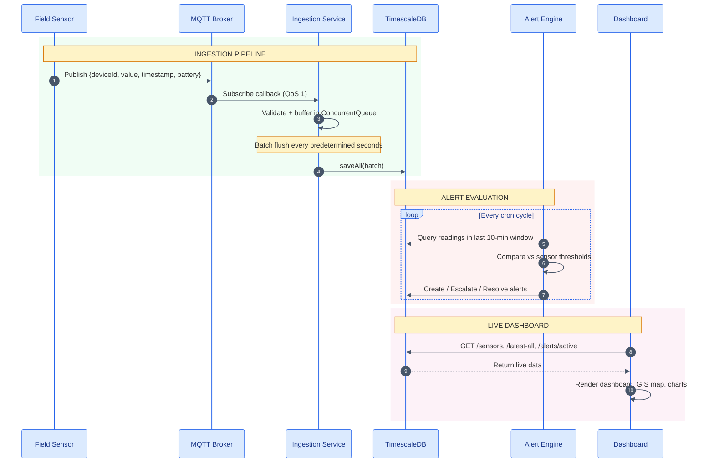
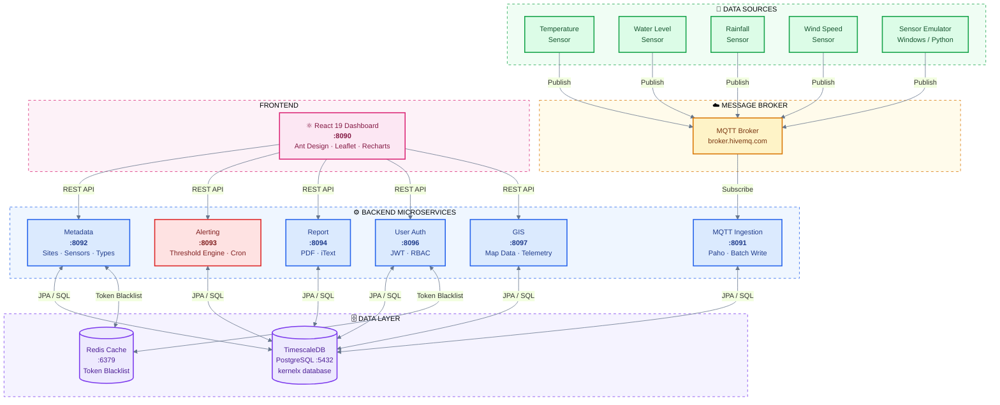

<div align="center">


</div>


# 🌍 ATLAS – Adaptive Time-Series Analytics and Logging System
### Domain‑Agnostic Government Monitoring Platform


<p align="center">
  
</p>

**ATLAS** is a domain‑agnostic monitoring and management platform designed to be adapted by multiple government organizations. While the primary use case is **Integrated Hydro Risk Management**, the system is architected to support any domain requiring real-time measurements, historical analytics, and asset management.

## ✨ Core Features

<div align="center">

| | | |
|:---:|:---:|:---:|
|  🚨<br/>**Real-time Alerts**<br/><sub>Responsive interface for visualizing risk alerts and monitoring trends</sub> |  📡<br/>**Automated Data Ingestion**<br/><sub>Seamless MQTT-based processing of field sensor data</sub> |  🗂️<br/>**Metadata Management**<br/><sub>Full CRUD interfaces for disaster-related entities and configurations</sub> |
|  🧩<br/>**Microservices Architecture**<br/><sub>Decoupled backend services built for modularity and scalability</sub> |  🗺️<br/>**GIS-Based Dashboard**<br/><sub>Integrated mapping for spatial awareness of distributed field assets</sub> |  🔐<br/>**Role-Based Access & Secure Login**<br/><sub>Robust authentication and authorization across administrative levels</sub> |
|  📄<br/>**Reporting Service**<br/><sub>Automated periodic reports and data summaries for decision-makers</sub> |  📊<br/>**Analytics Dashboard**<br/><sub>Telemetry charts, battery status, and health scores at a glance</sub> |  ⚡<br/>**Domain-Agnostic by Design**<br/><sub>Adapt to any monitoring domain without re-architecting</sub> |

<br>


</div>

  * **Real-time Alerts**: A modern, responsive interface for visualizing risk alerts and   monitoring trends.<br>

  * **Automated Data Ingestion**: Seamless MQTT-based processing of field sensor data.<br>

  * **Metadata Management**: Full CRUD interfaces to manage disaster-related entities and configurations.<br>

  * **Microservices Architecture**: Decoupled backend services designed for modularity and scalability.<br>

  * **GIS‑Based Dashboard**: Integrated mapping for spatial awareness and real-time visualization of distributed field assets.<br>

  * **Role-Based Access & Secure Login**: Robust authentication and authorization to ensure data security across different administrative levels.<br>

  * **Reporting Service**: Automated generation of periodic reports and data summaries for decision-makers.<br>
  
  * **Analytics dashboard**: System status monitoring interactive dashboard with telemetry charts, battery status, and health scores<br>


---

## Data Flow within Application



---

## 📁 Repository Structure

```
e22-co2060-hydro-risk-management/          ← Main orchestration repo
│
├──  README.md                           ← You are here
├──  docker-compose.yml                  ← One-command full-stack launch
├──  .env.example                        ← Environment variable template
├──  LICENSE                             ← MIT License
├──  CONTRIBUTING.md                     ← Contribution guide
├──  SECURITY.md                         ← Security policy
├──  CHANGELOG.md                        ← Version history
│
├──  .github/
│   ├──  ISSUE_TEMPLATE/                 ← Bug report & feature request forms
│   ├──  PULL_REQUEST_TEMPLATE.md        ← PR checklist
│   └──  workflows/ci.yml               ← GitHub Actions CI pipeline
│
├──  docs/
│   ├──  ARCHITECTURE.md                 ← Deep-dive system design & diagrams
│   ├──  DEPLOYMENT.md                   ← Docker, manual & cloud deployment
│   ├──  CONFIGURATION.md                ← All environment & config options
│   ├──  API_REFERENCE.md               ← REST API documentation
│   └──  PROJECT_GUIDE.md               ← Quick start & feature guide
│
├──  additional-files/
│   └──  SensorEmulator_*.zip            ← Windows MQTT test publisher
│
│   ── Git Submodules (each an independent repo) ──────────────────
│
├──  mqtt-data-ingestion-service/        ← MQTT subscriber + TimescaleDB writer
├──  metadata-handling-service/          ← Sites, Sensors, SensorTypes CRUD
├──  disaster-management-alerting-service/ ← Threshold alert engine
├──  report-generating-service/          ← PDF report generation
├──  disaster-management-user-service/   ← Auth, JWT, RBAC
├──  gis-monitoring-service/             ← GIS & telemetry read API
└──  disaster-management-frontend/       ← React 19 dashboard (Vite + Nginx)
```
---


## 🏗️ System Architecture




### Service Reference

| Service | Port | Tech Stack | Description |
|---------|------|-----------|-------------|
| [MQTT Ingestion](mqtt-data-ingestion-service/) | 8091 | Spring Boot 4, Eclipse Paho, TimescaleDB | Subscribes to MQTT topic, validates, buffers and batch-writes sensor telemetry |
| [Metadata Service](metadata-handling-service/) | 8092 | Spring Boot 4, PostgreSQL, Redis, Swagger | Full CRUD API for Sites, Sensors, and SensorTypes with JWT protection |
| [Alerting Service](disaster-management-alerting-service/) | 8093 | Spring Boot 4, PostgreSQL, Spring Scheduler | Cron-based engine that creates, escalates, and resolves threshold alerts |
| [Report Service](report-generating-service/) | 8094 | Spring Boot 4, iText, Thymeleaf, PostgreSQL | Generates downloadable PDF reports from historical telemetry and alert data |
| [User/Auth Service](disaster-management-user-service/) | 8096 | Spring Boot 4, JWT, Spring Security, Redis | Authentication, JWT token management, and role-based access control |
| [GIS Service](gis-monitoring-service/) | 8097 | Spring Boot 4, PostgreSQL | Read-only API serving sensor positions and telemetry for the map dashboard |
| [Frontend](disaster-management-frontend/) | 8090 | React 19, Vite, Ant Design 5, Leaflet, Recharts | Interactive monitoring dashboard with GIS map and analytics |

<br>

### Tech Stack

<div>

<table>
<thead>
<tr>
<th colspan="2" align="center">Frontend</th>
<th colspan="2" align="center">Backend</th>
<th colspan="2" align="center">Infrastructure</th>
</tr>
<tr>
<th align="left">Component</th>
<th align="left" width="230">Technology</th>
<th align="left">Component</th>
<th align="left" width="230">Technology</th>
<th align="left">Component</th>
<th align="left" width="230">Technology</th>
</tr>
</thead>
<tbody>
<tr>
<td><b>Framework</b></td>
<td align="left"> </td>
<td><b>Framework</b></td>
<td align="left"></td>
<td><b>Containerization</b></td>
<td align="left"> </td>
</tr>
<tr>
<td><b>Language</b></td>
<td align="left"><br/></td>
<td><b>Language</b></td>
<td align="left"></td>
<td><b>Web Server</b></td>
<td align="left"><br/><sub><i>Frontend</i></sub></td>
</tr>
<tr>
<td><b>UI Library</b></td>
<td align="left"></td>
<td><b>Database</b></td>
<td align="left"><br/></td>
<td><b>Time-series DB</b></td>
<td align="left"><br/><sub><i>PostgreSQL extension</i></sub></td>
</tr>
<tr>
<td><b>Maps</b></td>
<td align="left"></td>
<td><b>Cache</b></td>
<td align="left"></td>
<td><b>Message Broker</b></td>
<td align="left"><br/>or any MQTT broker</td>
</tr>
<tr>
<td><b>Charts</b></td>
<td align="left"></td>
<td><b>Security</b></td>
<td align="left"><br/></td>
<td></td><td></td>
</tr>
<tr>
<td><b>HTTP Client</b></td>
<td align="left"></td>
<td><b>MQTT Client</b></td>
<td align="left"></td>
<td></td><td></td>
</tr>
<tr>
<td><b>Routing</b></td>
<td align="left"></td>
<td><b>PDF Generation</b></td>
<td align="left"><br/></td>
<td></td><td></td>
</tr>
<tr>
<td></td><td></td>
<td><b>API Docs</b></td>
<td align="left"></td>
<td></td><td></td>
</tr>
<tr>
<td></td><td></td>
<td><b>Build</b></td>
<td align="left"></td>
<td></td><td></td>
</tr>
</tbody>
</table>

</div>

---

## ✨ Key Features

<table>
<tr>
<td width="50%">

### 📊 Analytics Dashboard
- System health score gauge
- Battery level distribution chart
- Reading occurrence timeline
- Threshold status breakdown
- Sensor table with search, filter, and sort
- Per-sensor historical trend drawer
- Auto-refresh every 30 seconds

</td>
<td width="50%">

### 🗺️ GIS Map Dashboard
- Interactive Leaflet map (OpenStreetMap)
- Color-coded sensor markers by alert severity
- Animated pulse effect on active alerts
- Sensor search autocomplete
- Fly-to animation on sensor selection
- Detail drawer with telemetry chart

</td>
</tr>
<tr>
<td>

### 🚨 Alerting Engine
- Cron-based updates cycle
- 4-level severity hierarchy
- Escalation and de-escalation
- Auto-resolution when normal
- Configurable alert retention
- Sliding time-window evaluation

</td>
<td>

### 🔐 Security
- JWT access tokens (15 min)
- Refresh tokens (1 day, HttpOnly cookie)
- Redis-backed token blacklisting
- Role-based access (ADMIN / USER)
- Auto token refresh on 401
- Seeded admin account on first boot

</td>
</tr>
</table>

---

## ⚡ Quick Start

Get the full platform running locally in under 5 minutes:

```bash
# 1. Clone with all submodules
git clone --recurse-submodules https://github.com/cepdnaclk/e22-co2060-hydro-risk-management.git
cd e22-co2060-hydro-risk-management

# 2. Configure your environment
cp .env.example .env
# Edit .env: set POSTGRES_PASSWORD, JWT_SECRET, ADMIN_PASSWORD

# 3. Launch the entire 9-container stack
docker compose up --build -d

# 4. Open the dashboard
# http://localhost:8090  →  Login: admin / admin123
```

> **First boot:** Takes ~3–5 minutes while TimescaleDB initializes and Spring Boot services start. Services auto-retry connections.

### Access Points

| Service | URL | Notes |
|---------|-----|-------|
| 🌐 **Dashboard** | http://localhost:8090 | `admin` / `admin123` |
| 📋 **Metadata API Swagger** | http://localhost:8092/swagger-ui.html | Interactive API docs |
| 👤 **Auth API Swagger** | http://localhost:8096/swagger-ui.html | Interactive API docs |


---

## 📖 Documentation Index

| Document | Description |
|----------|-------------|
| [ARCHITECTURE.md](ARCHITECTURE.md) | Deep-dive system design — service internals, DB schema, security flows, design decisions |
| [DEPLOYMENT.md](DEPLOYMENT.md) | Docker Compose, manual, cloud (AWS, GKE, Swarm), production checklist |
| [API_REFERENCE.md](API_REFERENCE.md) | Complete REST API docs for all 6 backend services with request/response examples |
| [CONFIGURATION.md](CONFIGURATION.md) | All environment variables, application.yml options, and config reference |
| [PROJECT_GUIDE.md](PROJECT_GUIDE.md) | Quick-start guide, alert system explained, domain adaptation steps |
| [SECURITY.md](SECURITY.md) | Security policy, production hardening checklist, responsible disclosure |

---


## 👥 Team - KernelX

| Member | ID | Contact |
|--------|----|---------|
| Dinith Kariyawasam | E/22/182 | e22182@eng.pdn.ac.lk |
| Rameesha Prathapasinghe | E/22/291 | e22291@eng.pdn.ac.lk |
| Tharindu Weerasinghe | E/22/421 | e22421@eng.pdn.ac.lk |
| Gayumi Wimalaweera | E/22/449 | e22449@eng.pdn.ac.lk |

**Supervised by:** Prof. Kamalanath Samarakoon  
**Module:** CO2060 Software Systems Design  
**Department of Computer Engineering, University of Peradeniya**


---

