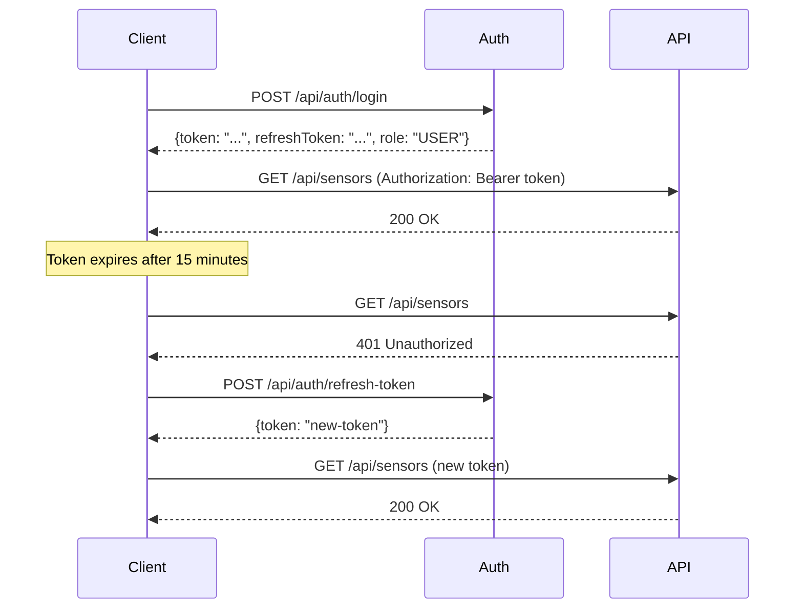

# 📡 API Reference

Complete REST API documentation for all ATLAS backend services.

> **Base URLs (local Docker):**
> - User/Auth Service: `http://localhost:8096/api`
> - Metadata Service: `http://localhost:8092/api`
> - Alerting Service: `http://localhost:8093/disaster-management`
> - GIS/Telemetry Service: `http://localhost:8097/disaster-management`
> - Report Service: `http://localhost:8094`

> **Interactive Swagger UI:**
> - Metadata: http://localhost:8092/swagger-ui.html
> - Auth: http://localhost:8096/swagger-ui.html

---

## 🔐 Authentication

Most endpoints require a **Bearer token** obtained from the Auth Service.

```http
Authorization: Bearer <your-access-token>
```

**Token lifecycle:**



---

## 👤 User / Auth Service (:8096)

### POST `/api/auth/login`
Authenticate and receive JWT tokens.

**Request body:**
```json
{
  "username": "admin",
  "password": "admin123"
}
```

**Response `200 OK`:**
```json
{
  "token": "eyJhbGci...",
  "refreshToken": "eyJhbGci...",
  "username": "admin",
  "role": "ADMIN"
}
```

**Errors:** `401` — Invalid credentials

---

### POST `/api/auth/refresh-token`
Get a new access token using the refresh token.

**Request body:**
```json
{
  "refreshToken": "eyJhbGci..."
}
```

**Response `200 OK`:**
```json
{
  "token": "eyJhbGci...",
  "refreshToken": "eyJhbGci...",
  "username": "admin",
  "role": "ADMIN"
}
```

**Errors:** `400` — Invalid or blacklisted refresh token

---

### POST `/api/auth/logout`
Invalidate both tokens (adds to Redis blacklist).

**Headers:** `Authorization: Bearer <access-token>`

**Request body:**
```json
{
  "refreshToken": "eyJhbGci..."
}
```

**Response `200 OK`:** Empty body

---

### GET `/api/users`
List all users. **Requires ADMIN role.**

**Headers:** `Authorization: Bearer <admin-token>`

**Response `200 OK`:**
```json
[
  {
    "id": 1,
    "username": "admin",
    "role": "ADMIN"
  },
  {
    "id": 2,
    "username": "operator1",
    "role": "USER"
  }
]
```

---

### POST `/api/users`
Create a new user. **Requires ADMIN role.**

**Request body:**
```json
{
  "username": "operator1",
  "password": "securePassword123",
  "role": "USER"
}
```

**Response `201 Created`:**
```json
{
  "id": 2,
  "username": "operator1",
  "role": "USER"
}
```

---

### PUT `/api/users/{id}`
Update a user. **Requires ADMIN role.**

**Request body:**
```json
{
  "username": "operator1",
  "role": "ADMIN"
}
```

---

### DELETE `/api/users/{id}`
Delete a user. **Requires ADMIN role.**

**Response `204 No Content`**

---

### PUT `/api/users/{id}/change-password`
Change a user's password.

**Request body:**
```json
{
  "currentPassword": "old123",
  "newPassword": "new456"
}
```

---

## 🗃️ Metadata Service (:8092)

All endpoints require a valid Bearer token unless otherwise noted.

### Sites

#### GET `/api/sites`
Retrieve all monitoring sites.

**Response `200 OK`:**
```json
[
  {
    "siteId": 1,
    "siteName": "Kelani River Sector",
    "location": "Western Province, Sri Lanka",
    "latitude": 6.9497,
    "longitude": 80.0150
  }
]
```

#### POST `/api/sites`
Create a new site.

```json
{
  "siteName": "Mahaweli Upper Zone",
  "location": "Central Province",
  "latitude": 7.2896,
  "longitude": 80.6324
}
```

#### GET `/api/sites/{id}` — Get by ID
#### PUT `/api/sites/{id}` — Update site
#### DELETE `/api/sites/{id}` — Delete site

---

### Sensor Types

#### GET `/api/sensor-types`
List all sensor types.

```json
[
  {
    "sensorTypeId": 1,
    "type": "Water Level Sensor",
    "description": "Measures river and reservoir water levels in meters"
  }
]
```

#### POST `/api/sensor-types`
```json
{
  "type": "Rainfall Sensor",
  "description": "Measures precipitation in mm/hour"
}
```

#### GET `/api/sensor-types/{id}` — Get by ID
#### PUT `/api/sensor-types/{id}` — Update
#### DELETE `/api/sensor-types/{id}` — Delete

---

### Sensors

#### GET `/api/sensors`
List all sensors (with site and type info).

**Response `200 OK`:**
```json
[
  {
    "sensorId": "1001",
    "siteId": 1,
    "sensorTypeId": 1,
    "latitude": 6.9497,
    "longitude": 80.0150,
    "unitOfMeasure": "m",
    "thresholdHighCritical": 8.0,
    "thresholdHighWarning": 6.0,
    "thresholdLowWarning": 2.0,
    "thresholdLowCritical": 1.0,
    "sensorType": {
      "sensorTypeId": 1,
      "type": "Water Level Sensor"
    },
    "site": {
      "siteId": 1,
      "siteName": "Kelani River Sector"
    }
  }
]
```

#### POST `/api/sensors`
Register a new sensor.

```json
{
  "sensorId": "WL-001",
  "siteId": 1,
  "sensorTypeId": 1,
  "latitude": 6.9497,
  "longitude": 80.0150,
  "unitOfMeasure": "m",
  "thresholdHighCritical": 8.0,
  "thresholdHighWarning": 6.0,
  "thresholdLowWarning": 2.0,
  "thresholdLowCritical": 1.0
}
```

#### GET `/api/sensors/{id}` — Get by sensor ID
#### PUT `/api/sensors/{id}` — Update sensor (including thresholds)
#### DELETE `/api/sensors/{id}` — Delete sensor

---

## 🚨 Alerting Service (:8093)

### GET `/disaster-management/alerts/active`
Get all currently active (unresolved) alerts.

**Response `200 OK`:**
```json
[
  {
    "alertId": "3fa85f64-5717-4562-b3fc-2c963f66afa6",
    "timestamp": "2025-01-15T10:30:00Z",
    "firstCreatedAt": "2025-01-15T09:15:00Z",
    "sensorId": "1001",
    "severity": "HIGH_WARNING",
    "measurement": 6.83,
    "threshold": 6.0
  }
]
```

**Severity values:** `HIGH_CRITICAL` | `HIGH_WARNING` | `LOW_WARNING` | `LOW_CRITICAL`

**Response `500`:** Internal error during alert fetch

---

## 🗺️ GIS / Telemetry Service (:8097)

### GET `/disaster-management/telemetry/sensor/{sensorId}?range={range}`
Historical telemetry for a sensor.

**Path params:**
- `sensorId` — Sensor ID (e.g., `1001`)

**Query params:**
- `range` — One of: `1h`, `24h`, `7d`, `30d`

**Response `200 OK`:**
```json
[
  {
    "sensorId": "1001",
    "timestamp": "2025-01-15T09:00:00Z",
    "measurement": 5.42,
    "batteryStatus": 87,
    "sensorHealth": 98
  },
  {
    "sensorId": "1001",
    "timestamp": "2025-01-15T10:00:00Z",
    "measurement": 6.83,
    "batteryStatus": 86,
    "sensorHealth": 97
  }
]
```

---

### GET `/disaster-management/telemetry/sensor/{sensorId}/latest`
Latest single reading for a sensor.

**Response `200 OK`:**
```json
{
  "sensorId": "1001",
  "timestamp": "2025-01-15T10:30:00Z",
  "measurement": 6.83,
  "batteryStatus": 85,
  "sensorHealth": 97
}
```

---

### GET `/disaster-management/telemetry/latest-all`
Latest reading for **all sensors** in a single call (used by the main dashboard).

**Response `200 OK`:**
```json
[
  {
    "sensorId": "1001",
    "timestamp": "2025-01-15T10:30:00Z",
    "measurement": 6.83,
    "batteryStatus": 85
  },
  {
    "sensorId": "1002",
    "timestamp": "2025-01-15T10:28:00Z",
    "measurement": 3.21,
    "batteryStatus": 92
  }
]
```

---

### GET `/disaster-management/alerts/active`
Active alerts (same data as Alerting Service, served through GIS service for map overlay).

---

## 📄 Report Service (:8094)

Reports are returned as downloadable **PDF files** (`Content-Type: application/pdf`).

### POST `/reports/telemetry`
Generate a telemetry data report.

**Request body:**
```json
{
  "sensorId": "1001",
  "startDate": "2025-01-01T00:00:00Z",
  "endDate": "2025-01-31T23:59:59Z",
  "reportTitle": "January Water Level Report — Kelani River"
}
```

**Response `200 OK`:** PDF binary (`application/pdf`)

---

### POST `/reports/alerts`
Generate an alert history report.

**Request body:**
```json
{
  "startDate": "2025-01-01T00:00:00Z",
  "endDate": "2025-01-31T23:59:59Z",
  "reportTitle": "January Alert Summary"
}
```

**Response `200 OK`:** PDF binary (`application/pdf`)

---

## 📥 MQTT Data Ingestion (Not REST — MQTT Protocol)

The ingestion service subscribes to an MQTT topic, not a REST endpoint. You publish to it from your sensor devices.

**Topic pattern:** `thw/telemetry/{sensorId}` (configurable)

**Payload (JSON):**
```json
{
  "deviceId": "1001",
  "value": 6.83,
  "timestamp": "2025-01-15T10:30:00Z",
  "sensorHealth": 98,
  "batteryStatus": 85
}
```

| Field | Type | Required | Description |
|-------|------|----------|-------------|
| `deviceId` | String | ✅ | Must match a registered sensor ID |
| `value` | Number | ✅ | The sensor measurement in the sensor's unit |
| `timestamp` | ISO 8601 | ✅ | UTC timestamp of the reading |
| `sensorHealth` | Number (0–100) | ❌ | Sensor self-reported health percentage |
| `batteryStatus` | Number (0–100) | ❌ | Battery charge level percentage |

**Validation:** Messages with missing `deviceId`, `value`, or `timestamp` are rejected and logged as warnings. Invalid messages do not cause service errors.

---

## 🔢 HTTP Status Codes

| Code | Meaning |
|------|---------|
| `200 OK` | Success |
| `201 Created` | Resource created successfully |
| `204 No Content` | Success, no body (DELETE operations) |
| `400 Bad Request` | Invalid request body or parameters |
| `401 Unauthorized` | Missing or invalid JWT token |
| `403 Forbidden` | Authenticated but insufficient role |
| `404 Not Found` | Resource not found |
| `500 Internal Server Error` | Unexpected server error |
