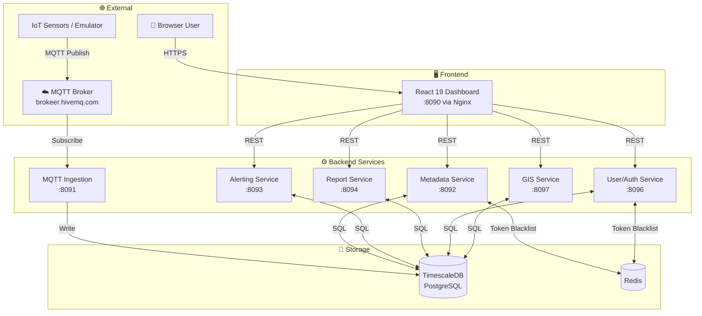
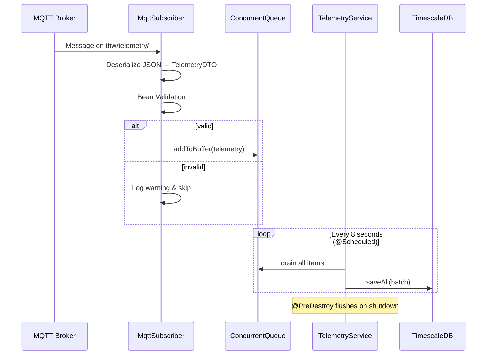
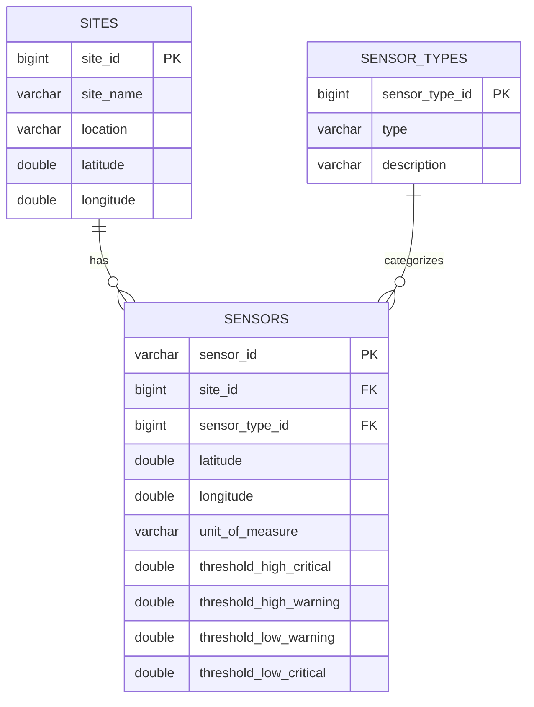
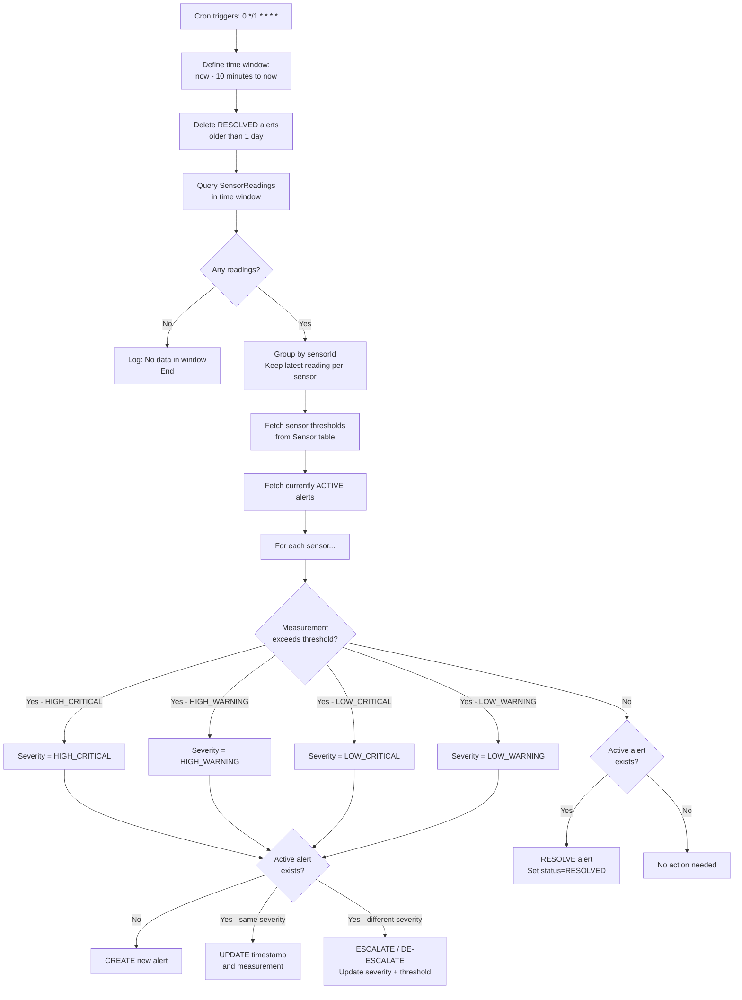
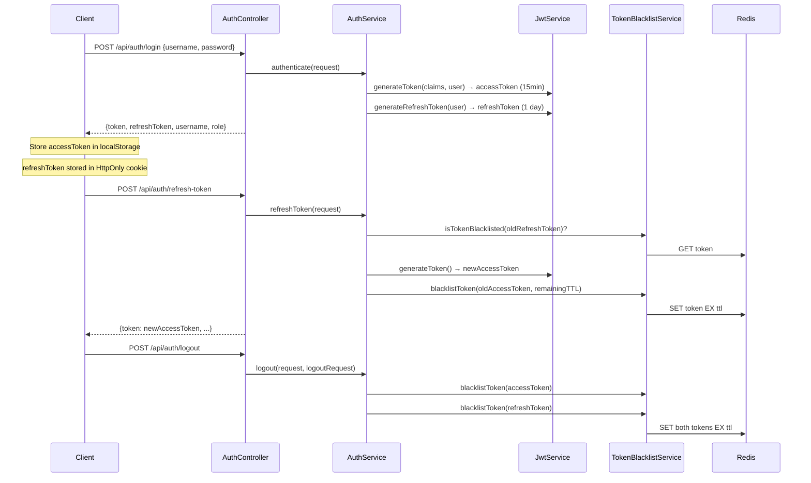
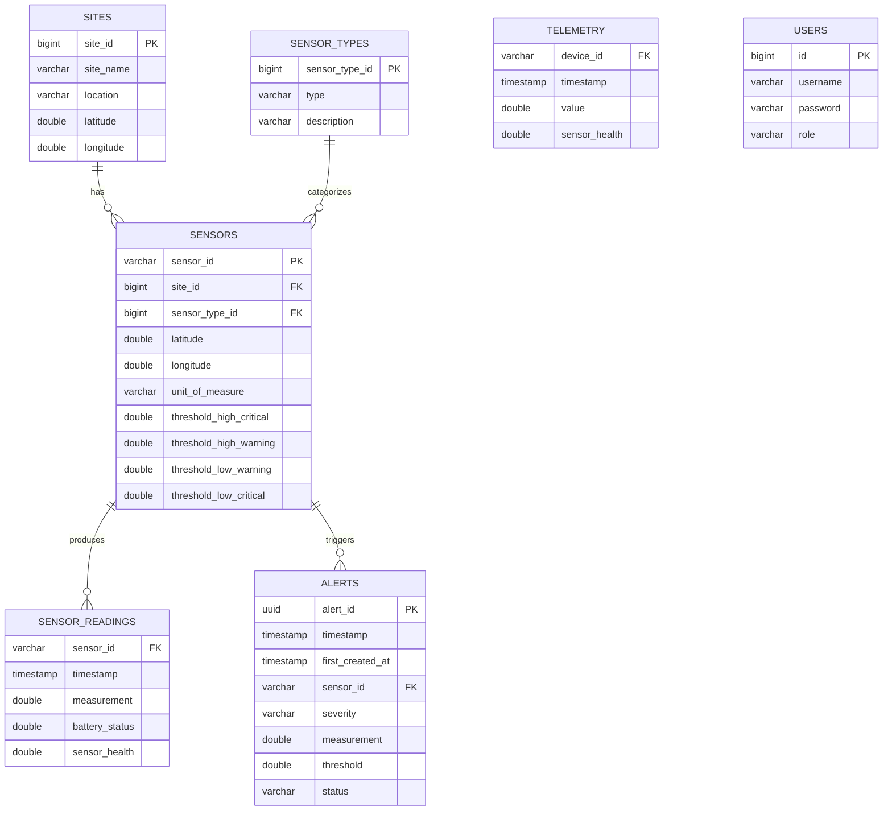
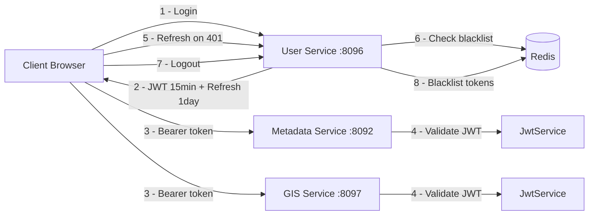

# 🏗️ ATLAS Architecture Guide

> **Audience:** Developers who want to understand, extend, or fork ATLAS.

---

## Table of Contents

- [System Overview](#system-overview)
- [Microservices Architecture](#microservices-architecture)
- [Service Internals](#service-internals)
  - [MQTT Ingestion Service](#mqtt-ingestion-service)
  - [Metadata Handling Service](#metadata-handling-service)
  - [Alerting Service](#alerting-service)
  - [Report Generating Service](#report-generating-service)
  - [User / Auth Service](#user--auth-service)
  - [GIS Monitoring Service](#gis-monitoring-service)
  - [Frontend](#frontend)
- [Database Design](#database-design)
- [Security Architecture](#security-architecture)
- [Data Flow](#data-flow)
- [Design Decisions & Trade-offs](#design-decisions--trade-offs)
- [Adapting to a New Domain](#adapting-to-a-new-domain)

---

## System Overview

ATLAS follows a **microservices architecture** where each service is independently deployable and owns a well-defined functional area. All services share a single **TimescaleDB** (PostgreSQL with time-series extension) database and communicate through REST APIs.



---

## Microservices Architecture

### Why Microservices?

ATLAS uses microservices to achieve:

| Goal | How ATLAS achieves it |
|------|----------------------|
| **Independent deployment** | Each service has its own Dockerfile and can be deployed separately |
| **Technology flexibility** | Each service can use different Spring Boot versions, dependencies |
| **Team ownership** | Each submodule is owned by a different team member |
| **Scalability** | High-load services (MQTT ingestion) can be scaled independently |
| **Domain isolation** | Alert logic, metadata, and auth are separate concerns |

### Shared Database Trade-off

ATLAS uses a **single shared database** across all services. This is a deliberate pragmatic choice:

- ✅ **Simpler** — no cross-service API calls to join data
- ✅ **Consistent** — no eventual consistency issues between services
- ✅ **Easier to set up** — one Docker container, one connection string
- ❌ **Tight coupling** — schema changes can affect multiple services
- ❌ **Less scalable** — database becomes a shared bottleneck at scale

> For academic/government deployments of this scale, shared database is the right trade-off. Production internet-scale deployments should consider service-specific schemas.

---

## Service Internals

### MQTT Ingestion Service

**Port:** 8091 | **Repo:** `mqtt-data-ingestion-service/mqttSubscriber`



**Key design choices:**
- **Buffered batch writes** — prevents DB overload from high-frequency sensor data. Trades slight latency (up to 8s) for throughput.
- **`ConcurrentLinkedQueue`** — thread-safe for concurrent MQTT callback threads vs. scheduler flush thread.
- **Persistent MQTT session** (`cleanSession=false`) — messages are queued by broker if service briefly disconnects.
- **Auto-reconnect** — handles transient network issues without manual intervention.

**MQTT Payload format:**
```json
{
  "deviceId": "1001",
  "value": 6.83,
  "timestamp": "2025-01-15T10:30:00Z",
  "sensorHealth": 98,
  "batteryStatus": 85
}
```

---

### Metadata Handling Service

**Port:** 8092 | **Repo:** `metadata-handling-service`

Manages the three core domain entities with full CRUD:

```
Site (1) ──────< Sensor (N) >────── SensorType (1)
```

**Entity model:**



**Security:** All write endpoints are JWT-protected. Read endpoints may be public or protected depending on your deployment.

---

### Alerting Service

**Port:** 8093 | **Repo:** `disaster-management-alerting-service`

The alert engine uses a **DDD (Domain-Driven Design) layered architecture**:

```
com.kernelx.alerts/
├── application/
│   ├── config/      SchedulingConfig.java
│   ├── controller/  AlertsController.java
│   └── scheduler/   AlertScheduler.java
├── domain/
│   ├── entities/    Alert, Sensor, SensorReading
│   ├── enums/       AlertSeverity, AlertStatus
│   ├── exception/   BaseException, ServerException
│   ├── model/       DTOs and responses
│   └── service/     AlertsService (interface + impl)
└── external/
    └── repository/  AlertRepository, SensorReadingRepository, SensorRepository
```

**Alert evaluation algorithm (every 1 minute):**



**REST API:**
```
GET /disaster-management/alerts/active  →  List<ActiveAlertResponse>
```

---

### Report Generating Service

**Port:** 8094 | **Repo:** `report-generating-service`

Generates downloadable PDF reports using **iText** via **Thymeleaf HTML templates**.

```
Request with date range
        ↓
TelemetryReportController / AlertReportController
        ↓
TelemetryReportService / AlertReportService
        ↓
Query historical data from DB (SensorReading, Telemetry, Alert tables)
        ↓
Render Thymeleaf HTML template (src/main/resources/templates/)
        ↓
iText converts HTML → PDF bytes
        ↓
Return as application/pdf response (downloadable)
```

**Report types:**
- **Telemetry Report** — historical sensor readings with statistics for a date range
- **Alert Report** — alert events with severity distribution for a date range

---

### User / Auth Service

**Port:** 8096 | **Repo:** `disaster-management-user-service`



**Roles:**
- `ADMIN` — Full access including user management (`/admin/users`)
- `USER` — Standard access to monitoring dashboards

**Default seeded account (change in production!):**
```
username: admin
password: admin123
role: ADMIN
```

---

### GIS Monitoring Service

**Port:** 8097 | **Repo:** `gis-monitoring-service`

A **read-only** service that aggregates data from the shared database for efficient GIS map rendering. It avoids sending the client directly to multiple services.

**Endpoints:**
```
GET /disaster-management/sensors           → Sensor list with lat/long
GET /disaster-management/telemetry/sensor/{id}?range={1h|24h|7d|30d}
GET /disaster-management/telemetry/sensor/{id}/latest
GET /disaster-management/telemetry/latest-all
GET /disaster-management/alerts/active     → Active alerts for map markers
```

**Why a separate GIS service?**  
The frontend GIS dashboard needs data from three tables (sensors, sensor_readings, alerts). Rather than having the frontend call three different services and join data in JavaScript, the GIS service provides purpose-built aggregated endpoints, reducing round-trips and simplifying frontend logic.

---

### Frontend

**Port:** 8090 (Docker / Nginx) | **Repo:** `disaster-management-frontend`

```
src/
├── App.jsx                    ← Root routing, theme provider, auth guard
├── context/
│   ├── AuthContext.jsx        ← Global auth state (JWT, user role)
│   └── SystemStatusContext.jsx ← Backend connectivity monitoring
├── components/
│   ├── Layout/
│   │   ├── Sidebar.jsx        ← Navigation sidebar
│   │   └── ProtectedRoute.jsx ← Auth + RBAC route guard
│   └── UI/
│       ├── TelemetryChart.tsx         ← Recharts line chart with threshold lines
│       ├── SystemHealthGauge.tsx      ← Circular gauge (health score)
│       ├── BatteryDistributionChart.tsx ← Battery level bar chart
│       ├── TimelineVisualizationChart.tsx ← Scatter plot (reading occurrence)
│       └── ThresholdDistributionChart.tsx ← Donut chart (severity breakdown)
├── pages/
│   ├── Dashboard.jsx          ← Main analytics + sensor table
│   ├── GisDashboard.tsx       ← Leaflet map + sensor markers
│   ├── Alerts.jsx             ← Active alert list
│   ├── TelemetryData.jsx      ← Raw readings browser
│   ├── Reports.jsx            ← PDF report generation
│   ├── auth/Login.jsx         ← Login form
│   ├── user/Profile.jsx       ← User profile
│   ├── admin/UserManagement.jsx ← Admin: manage users
│   └── metadata/
│       ├── Sites.jsx          ← Sites CRUD
│       ├── SensorTypes.jsx    ← SensorTypes CRUD
│       └── Sensors.jsx        ← Sensors CRUD
└── services/
    ├── api.js                 ← Axios for User Service (:8096) + auto-refresh
    ├── metadataApi.js         ← Axios for Metadata Service (:8092)
    ├── alertsApi.js           ← Axios for Alerting Service (:8093)
    ├── gisTelemetryApi.ts     ← Axios for GIS Service (:8097) + mock fallback
    └── reportsApi.js          ← Axios for Report Service (:8094)
```

**Mock data fallback:**  
All API service files include graceful fallback to realistic mock data when the backend is unavailable. This allows the frontend to be developed and demonstrated without running all backend services.

---

## Database Design

All services share the `kernelx` database:



> **TimescaleDB:** `sensor_readings` and `telemetry` are time-series hypertables. TimescaleDB automatically partitions them by time, providing excellent query performance for time-range queries.

---

## Security Architecture



**Key security properties:**
1. **Short-lived access tokens (15 min)** — limits damage if a token is stolen
2. **HttpOnly refresh token cookie** — not accessible via JavaScript, protects against XSS
3. **Redis token blacklisting** — enables immediate token invalidation on logout
4. **Role enforcement** — `ADMIN` routes are guarded both in frontend (`ProtectedRoute`) and backend

---

## Data Flow

### Sensor → Dashboard (full path)

```
1. Sensor publishes MQTT message to broker.hivemq.com
   Topic: thw/telemetry/1001
   Payload: {"deviceId":"1001","value":6.83,"timestamp":"...","batteryStatus":85,"sensorHealth":98}

2. MqttSubscriber.handleMessage() receives it
   → Deserializes to TelemetryDTO
   → Validates (Bean Validation)
   → Adds to ConcurrentQueue buffer

3. TelemetryService.flushBuffer() runs every 8 seconds
   → Drains queue into a List<Telemetry>
   → repository.saveAll(batch) → TimescaleDB

4. AlertScheduler runs every 1 minute
   → Queries sensor_readings for last 10 minutes
   → Compares latest reading per sensor vs threshold
   → Creates/Updates/Resolves alerts in DB

5. Frontend Dashboard polls every 30 seconds (or user clicks Refresh)
   → GET /disaster-management/telemetry/latest-all  (GIS Service)
   → GET /api/sensors  (Metadata Service)
   → GET /disaster-management/alerts/active  (GIS Service)
   → Renders KPI cards, charts, sensor table

6. User clicks sensor marker on GIS map
   → GET /disaster-management/telemetry/sensor/1001?range=24h
   → Renders telemetry trend chart in drawer
```

---

## Design Decisions & Trade-offs

| Decision | Rationale | Trade-off |
|----------|-----------|-----------|
| Shared PostgreSQL DB | Simplicity, easy joins, single backup | Tight coupling, shared bottleneck |
| TimescaleDB extension | Time-series query efficiency, automatic partitioning | Requires TimescaleDB-specific Docker image |
| Public MQTT broker (HiveMQ) | Zero infrastructure for development/demo | Not suitable for production (public, unencrypted) |
| Cron-based alerting (pull) | Simple, stateless, restartable | 1-minute latency vs real-time WebSocket push |
| Buffer + batch write for MQTT | Protects DB from high-frequency writes | Up to 8-second delay before data appears |
| DDD layering in Alerting Service | Clear separation of concerns | More boilerplate than a flat service |
| Mock data fallback in frontend | Demo-ability without full backend | May hide real API issues during development |
| No API Gateway | Fewer moving parts | Each service must handle its own auth |

---

## Adapting to a New Domain

ATLAS's domain is encoded **only in your data**, not in the code. To adapt ATLAS:

1. **Add sensor types** via the Metadata API (e.g., "Air Quality Sensor", "Traffic Counter")
2. **Register sites** for your geographic locations
3. **Register sensors** with appropriate threshold values for your domain
4. **Change the MQTT topic** in `application.yml` to match your device firmware
5. **Update the MQTT payload format** if your devices use different field names (update `TelemetryDTO.java`)

No changes to the alert engine, dashboard, or GIS map are needed — they work generically with any sensor data.
