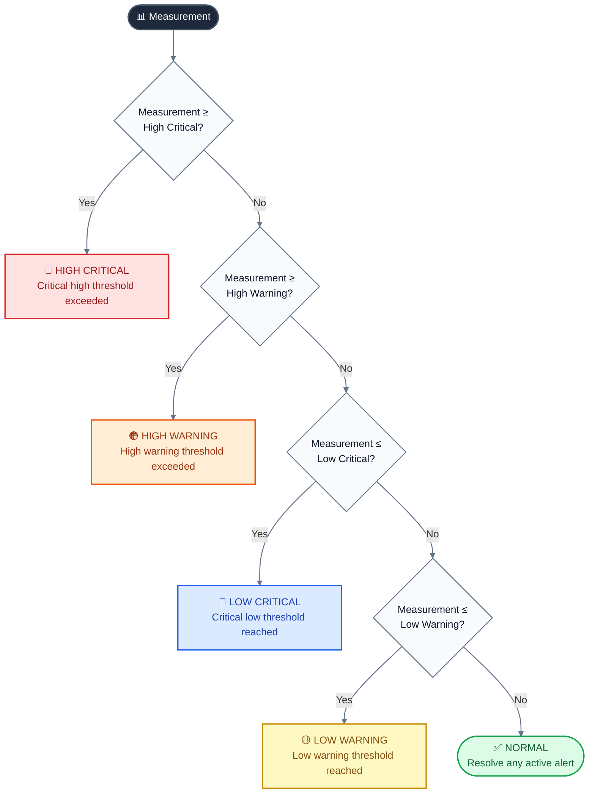

# Project Guide

---

## ⚡ Quick Start (5 minutes with Docker)

### Prerequisites

| Tool | Version | Install |
|------|---------|---------|
| Docker | 24+ | [Get Docker](https://docs.docker.com/get-docker/) |
| Docker Compose | 2.20+ | Included with Docker Desktop |
| Git | 2.30+ | [Get Git](https://git-scm.com/downloads) |

### 1. Clone with submodules

```bash
git clone --recurse-submodules https://github.com/cepdnaclk/e22-co2060-hydro-risk-management.git
cd e22-co2060-hydro-risk-management
```

> **Already cloned without submodules?**
> ```bash
> git submodule update --init --recursive
> ```

### 2. Configure environment

```bash
cp .env.example .env
# Edit .env with your settings (JWT secret, DB password, etc.)
```

### 3. Start all services

```bash
docker compose up --build -d
```

### 4. Open the dashboard

| Service | URL | Credentials |
|---------|-----|-------------|
| 🌐 Frontend Dashboard | http://localhost:8090 | admin / admin123 |
| 📋 Metadata API Swagger | http://localhost:8092/swagger-ui.html | — |
| 👤 Auth API Swagger | http://localhost:8096/swagger-ui.html | — |

> **First boot takes ~3–5 minutes** while TimescaleDB initializes. Services will auto-retry connections.

### 5. Send test data (optional)

Use the included sensor emulator to push test readings over MQTT:

```bash
# Python emulator (cross-platform)
cd additional-files
pip install paho-mqtt
python sensor_emulator.py --sensor-id 1001 --type water-level

# Or use the Windows Forms app: additional-files/SensorEmulator_2YP_WindowsFormsApp.zip
```

---

## 🛑 Stopping & Cleanup

```bash
# Stop all services (data preserved)
docker compose down

# Stop and remove all data volumes (fresh start)
docker compose down -v
```

---

## 🚨 Alert System Explained

ATLAS supports **4 severity levels** per sensor, configurable independently:



**Each sensor defines its own thresholds** (stored in the `sensors` table):

| Field | Example (Water Level) | Meaning |
|---|---|---|
| `thresholdHighCritical` | 8.0 m | Immediate danger — flood risk |
| `thresholdHighWarning` | 6.0 m | Warning — elevated level |
| `thresholdLowWarning` | 2.0 m | Low — potential drought |
| `thresholdLowCritical` | 1.0 m | Critical — very low |

---

## 🌐 Adapting ATLAS to Your Domain

ATLAS is designed to work for **any domain with field sensors**. Here's how to adapt it:

### Step 1: Register your sensor types
```bash
POST http://localhost:8092/api/sensor-types
{
  "type": "Air Quality Sensor",
  "description": "Measures PM2.5 and CO2 levels"
}
```

### Step 2: Register your sites and sensors
```bash
POST http://localhost:8092/api/sites
{ "siteName": "City Center Station A", "location": "Colombo", "latitude": 6.9271, "longitude": 79.8612 }

POST http://localhost:8092/api/sensors
{
  "sensorId": "AQ-001",
  "siteId": 1, "sensorTypeId": 1,
  "thresholdHighCritical": 150, "thresholdHighWarning": 100,
  "thresholdLowCritical": 0, "thresholdLowWarning": 10,
  "unitOfMeasure": "µg/m³",
  "latitude": 6.9271, "longitude": 79.8612
}
```

### Step 3: Configure your MQTT topic
Edit `mqtt-data-ingestion-service/mqttSubscriber/src/main/resources/application.yml`:
```yaml
mqtt:
  broker: tcp://your-broker.com:1883
  topic: your/telemetry/topic/#   # Change this to match your device topic structure
```

### Step 4: Publish sensor data
```json
{
  "deviceId": "AQ-001",
  "value": 87.5,
  "timestamp": "2025-01-15T10:30:00Z",
  "sensorHealth": 98,
  "batteryStatus": 85
}
```

That's it — alerts, dashboards, and maps work automatically!

---

## ✨ Key Features

<table>
<tr>
<td width="50%">

### 📊 Analytics Dashboard
- System health score gauge
- Battery level distribution chart
- Reading occurrence timeline (scatter)
- Threshold status breakdown (donut chart)
- Sensor table with search, filter, and sort
- Per-sensor historical trend drawer
- Auto-refresh every 30 seconds

</td>
<td width="50%">

### 🗺️ GIS Map Dashboard
- Interactive Leaflet map (OpenStreetMap)
- Color-coded sensor markers by alert severity
- Animated pulse effect on active alerts
- Sensor search autocomplete
- Fly-to animation on sensor selection
- Detail drawer with telemetry chart

</td>
</tr>
<tr>
<td>

### 🚨 Alerting Engine
- Cron-based
- 4-level severity hierarchy
- Escalation and de-escalation
- Auto-resolution when normal
- Configurable alert retention
- Sliding time-window evaluation

</td>
<td>

### 🔐 Security
- JWT access tokens (15 min)
- Refresh tokens (1 day, HttpOnly cookie)
- Redis-backed token blacklisting
- Role-based access (ADMIN / USER)
- Auto token refresh on 401
- Seeded admin account on first boot

</td>
</tr>
</table>

---

## 🛠️ Tech Stack

### Backend
| Component | Technology |
|-----------|-----------|
| Framework | Spring Boot 4.0 |
| Language | Java 21 |
| Database | PostgreSQL 14 + TimescaleDB |
| Cache | Redis |
| Security | Spring Security + JJWT |
| MQTT Client | Eclipse Paho |
| PDF Generation | iText + Thymeleaf |
| API Docs | SpringDoc OpenAPI (Swagger) |
| Build | Maven |

### Frontend
| Component | Technology |
|-----------|-----------|
| Framework | React 19 + Vite 7 |
| Language | JavaScript + TypeScript |
| UI Library | Ant Design 5 |
| Maps | React Leaflet + Leaflet.js |
| Charts | Recharts |
| HTTP Client | Axios |
| Routing | React Router 7 |

### Infrastructure
| Component | Technology |
|-----------|-----------|
| Containerization | Docker + Docker Compose |
| Web Server | Nginx (frontend) |
| Time-series DB | TimescaleDB (PostgreSQL extension) |
| Message Broker | HiveMQ (public) / Any MQTT broker |

---

