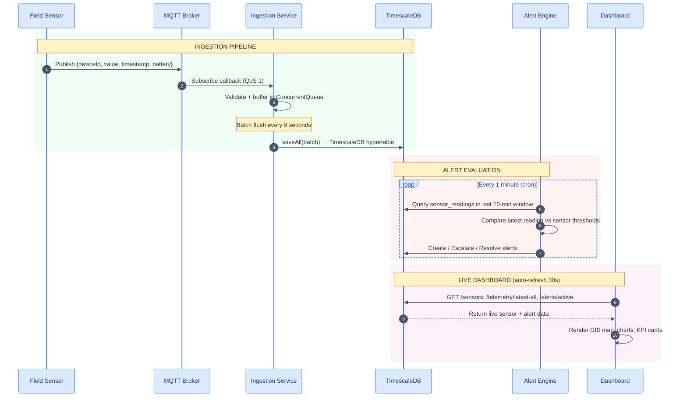
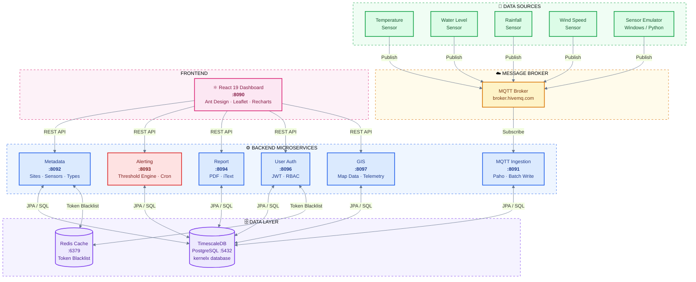
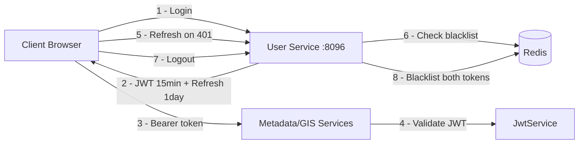

 

  
  
  
  
  
  
  

  
  
  
  
  

 

**A production-grade, domain-agnostic IoT monitoring and risk management platform** 
*built for government and critical infrastructure — from rivers to smart cities.*

 

# ATLAS – Adaptive Time-Series Analytics and Logging System  
### Domain-Agnostic Government Monitoring Platform

## Team

-  E/22/182, Dinith Kariyawasam, [e22182@eng.pdn.ac.lk](mailto:e22182@eng.pdn.ac.lk)
-  E/22/291, Rameesha Prathapasinghe, [e22291@eng.pdn.ac.lk](mailto:e22182@eng.pdn.ac.lk)
-  E/22/421, Tharindu Weerasinghe, [e22421@eng.pdn.ac.lk](mailto:e22182@eng.pdn.ac.lk)
-  E/22/449, Gayumi Wimalaweera, [e22449@eng.pdn.ac.lk](mailto:e22182@eng.pdn.ac.lk)

**Supervised by:** Prof. Kamalanath Samarakoon  
**Module:** CO2060 – Software Systems Design  
**Department of Computer Engineering, University of Peradeniya, Sri Lanka**

#### Table of Contents
1. [Introduction](#introduction)
2. [Live Dashboard Preview](#live-dashboard-preview)
3. [System Design](#system-design)
4. [System Architecture](#system-architecture)
5. [Feature Deep Dive](#feature-deep-dive)
6. [End Product](#end-product)
7. [Conclusion](#conclusion)

 

---

## Introduction

**ATLAS (Adaptive Time-Series Analytics and Logging System)** is a **domain-agnostic monitoring and management platform** designed to be adapted by multiple government organizations.

While the primary use case is **Integrated Hydro Risk Management**, the system is architected to support any domain requiring:

- Real-time measurements from field assets  
- Historical data analytics  
- Asset and infrastructure management  
- Scalable monitoring and reporting systems  

The platform connects **IoT field sensors → MQTT message broker → intelligent backend services → interactive GIS dashboard**, delivering a complete real-time situational awareness system for decision-makers and field operators.

ATLAS enables:

- Real-time and periodic data collection  
- Centralized logging and storage of time-series data  
- Efficient asset and metadata management  
- Scalable and modular system expansion  

The **ATLAS (Adaptive Time-Series Analytics and Logging System)** is a full-stack, microservices-based monitoring platform engineered for **Integrated Hydro Risk Management**: with the architectural flexibility to serve **any domain** involving field sensors, real-time data, and risk alerting platform.

*Domains ATLAS can serve out-of-the-box:*

| Domain | Sensor Types | Alert Meaning |
|--------|-------------|---------------|
| 🌊 Hydro Risk | Water level, Rainfall, Flow rate | Flood / drought alerts |
| 💧 Irrigation | Soil moisture, Tank level, Flow | Water stress / overflow |
| 🌿 Environment | Air quality, CO2, PM2.5, Temperature | Pollution thresholds |
| ⚡ Power Grid | Voltage, Current, Load | Outage / overload risk |
| 🏙️ Smart City | Traffic density, Noise, Humidity | Congestion / comfort |
| 🏭 Industrial | Pressure, Vibration, Temperature | Equipment fault detection |

> Originally developed as the primary use case for **flood and hydrological risk monitoring** across Sri Lankan river systems, ATLAS is built to scale seamlessly into irrigation networks, power distribution, environmental monitoring, and smart city infrastructure.

---

## Live Dashboard Preview

*Real-time GIS mapping, telemetry analytics, and intelligent alert management - all in one platform*

| | | |
|:---:|:---:|:---:|
| **GIS Live Map** Interactive Leaflet map with animated, severity-coded sensor markers and fly-to animations | **MQTT Data Ingestion** Persistent, auto-reconnecting subscriber with batch writes to TimescaleDB every 8 seconds | **4-Level Alert Engine** Cron-based sliding-window evaluation with escalation, de-escalation, and auto-resolution |
| **Analytics Dashboard** Health score gauges, battery charts, occurrence timelines, threshold donut charts — auto-refreshed | **JWT + RBAC Security** 15-min access tokens, HttpOnly refresh cookies, Redis blacklisting, and role-gated routes | **PDF Report Generation** Download telemetry and alert history reports for any date range via iText + Thymeleaf |
| **Microservices Architecture** 7 independently deployable services, each owning its domain — orchestrated by Docker Compose | **Domain-Agnostic** Adapt to any sensor domain without touching core code — just register types, sites, and thresholds | **One-Command Deployment** `docker compose up --build -d` launches the entire 9-container stack in under 5 minutes |

 

---

## System Design

### Real-Time Data Flow

 

### Technology Stack

<table>
<thead>
<tr>
<th colspan="2" align="center">Frontend</th>
<th colspan="2" align="center">Backend</th>
<th colspan="2" align="center">Infrastructure</th>
</tr>
</thead>
<tbody>
<tr>
<td>Framework</td>
<td> </td>
<td>Framework</td>
<td></td>
<td>Containers</td>
<td> </td>
</tr>
<tr>
<td>Language</td>
<td> </td>
<td>Language</td>
<td></td>
<td>Web Server</td>
<td></td>
</tr>
<tr>
<td>UI Library</td>
<td></td>
<td>Database</td>
<td> </td>
<td>Broker</td>
<td></td>
</tr>
<tr>
<td>Maps</td>
<td></td>
<td>Cache</td>
<td></td>
<td>CI/CD</td>
<td></td>
</tr>
<tr>
<td>Charts</td>
<td></td>
<td>Security</td>
<td> </td>
<td></td><td></td>
</tr>
<tr>
<td>HTTP</td>
<td></td>
<td>MQTT</td>
<td></td>
<td></td><td></td>
</tr>
<tr>
<td>Router</td>
<td></td>
<td>PDF</td>
<td> </td>
<td></td><td></td>
</tr>
</tbody>
</table>

---

## System Architecture

The platform follows a clean microservices topology with a shared TimescaleDB at the core, fronted by a React 19 SPA served through Nginx.

| Service | Tech Stack | Responsibility |
|---------|-----------|----------------|
| **MQTT Ingestion** | Spring Boot 4, Eclipse Paho, TimescaleDB | Subscribes to MQTT topic; validates, buffers, and batch-writes sensor telemetry into hypertables |
| **Metadata Service** | Spring Boot 4, PostgreSQL, Redis, Swagger | Full CRUD REST API for Sites, Sensors, and SensorTypes with JWT protection and OpenAPI docs |
| **Alerting Service** | Spring Boot 4, PostgreSQL, Spring Scheduler | Cron-based DDD engine that creates, escalates, and auto-resolves 4-level threshold alerts |
| **Report Service** | Spring Boot 4, iText, Thymeleaf, PostgreSQL | Generates downloadable PDF reports from historical telemetry and alert data |
| **User/Auth Service** | Spring Boot 4, JWT, Spring Security, Redis | Authentication, JWT lifecycle management, Redis-backed blacklisting, and RBAC |
| **GIS Service** | Spring Boot 4, PostgreSQL | Read-optimized aggregation API serving sensor positions, telemetry, and alerts for the map |
| **Frontend** | React 19, Vite 7, Ant Design 5, Leaflet, Recharts | Interactive monitoring SPA with GIS map, analytics charts, and metadata management |

 

*ATLAS System Architecture Diagram*

### Architecture and Design Decisions

1. **Shared TimescaleDB**: A single shared database simplifies the architecture, enables easy joins across services, and centralizes backups.

2. **TimescaleDB Extension**: The TimescaleDB extension provides efficient time-series querying and automatic time-based data partitioning.

3. **Public MQTT Broker**: A public MQTT broker eliminates the need to manage broker infrastructure during development and demonstrations.

4. **Cron-Based Alerting (Pull)**: Periodic cron-based evaluation keeps alerting simple, stateless, and easy to restart.

5. **Buffer and Batch Write**: Buffering incoming MQTT messages and writing them in batches protects the database from high-frequency data bursts.

6. **Domain-Driven Design (DDD) in the Alerting Service**: Separating domain, application, and infrastructure layers improves modularity, maintainability, and separation of concerns.

7. **Mock Data Fallback**: Mock data allows the frontend to remain fully demonstrable even when the backend is unavailable.

8. **No API Gateway**: Each service independently handles authentication validation, reducing architectural complexity and simplifying deployment.

---

## Feature Deep-Dives

### GIS Map Dashboard

The interactive map provides **real-time spatial awareness** of all deployed field assets:

- **OpenStreetMap tiles** rendered via React Leaflet
- **Color-coded sensor markers** driven by live alert severity
- **Animated pulse rings** on sensors with active alerts — drawing immediate operator attention
- **Sensor search autocomplete** with smooth fly-to animation on selection
- **Per-sensor detail drawer** with historical telemetry charts (1h / 24h / 7d / 30d time ranges)
- **Mock data fallback** the dashboard is fully demonstrable without backend connectivity

### Analytics Dashboard

A comprehensive operational intelligence view:

- **System Health Score** — circular gauge showing overall fleet health (0–100)
- **Battery Distribution Chart** — bar chart showing charge level across all sensors
- **Reading Occurrence Timeline** — scatter plot revealing sensor activity patterns
- **Threshold Breakdown Donut** — proportion of sensors in each severity band
- **Searchable Sensor Table** — filterable and sortable, with per-row trend drawer
- **Auto-refresh every 30 seconds** — always showing the latest state without manual reload

### Alert Engine

The alerting service implements a **4-level hierarchical severity model**, evaluated every minute using a sliding 10-minute window:

| Behaviour | Description |
|-----------|-------------|
| **Auto-create** | New alert raised when threshold is first crossed |
| **Escalation** | Severity upgraded if conditions worsen |
| **De-escalation** | Severity downgraded if conditions improve |
| **Auto-resolve** | Alert closed automatically when sensor returns to normal |
| **Retention** | Resolved alerts older than 1 day are pruned |

### Security Architecture

| Security Property | Implementation |
|-------------------|----------------|
| Short-lived access tokens | 15-minute JWT — limits blast radius of token theft |
| HttpOnly refresh cookie | Inaccessible to JavaScript — XSS-safe |
| Redis token blacklist | Immediate revocation on logout or token rotation |
| Role-Based Access Control | `ADMIN` and `USER` roles — gated at both frontend and backend |
| Auto token refresh | Axios interceptors transparently refresh tokens on `401` |

### Database Design

All services share the **`kernelx`** TimescaleDB database. Several tables are initialized as **hypertables**, thus automatically partitioned by time for high-throughput time-series queries.

- PostgreSQL relational database  
- Stores:
  - Asset metadata  
  - Historical records  
  - System configurations  

---

## End Product

### Testing

### Backend Testing
- **Unit & Integration tests** via JUnit 5 and Testcontainers (Alerting Service)
- **API endpoint testing** with Postman — validating CRUD operations, data validation, error handling, and JWT-protected routes

### Frontend Testing
- **UI testing** in browser — verifying API integration, data rendering, and user interactions
- **Mock data fallback** — ensures all pages load and function without backend dependencies

### Results
- ✅ Core functionalities operate correctly end-to-end
- ✅ Alert engine correctly creates, escalates, and resolves alerts
- ✅ JWT lifecycle (login → refresh → logout) operates with Redis blacklisting
- ✅ PDF report generation produces correct downloadable files
- ✅ System maintains data consistency across services

### Deployment Options

| Method | Best For | Command |
|--------|----------|---------|
| **Docker Compose** | Quick start, development, demo | `docker compose up --build -d` |
| **Manual / Dev Mode** | Active development of individual services | `./mvnw spring-boot:run` + `npm run dev` |
| **AWS EC2 + RDS** | Cloud production | See [DEPLOYMENT.md](DEPLOYMENT.md) |
| **Docker Swarm** | On-premise distributed | `docker stack deploy -c docker-compose.yml atlas` |
| **GKE / Kubernetes** | Enterprise-scale | Community contribution — see discussions |

---

## Conclusion

ATLAS successfully demonstrates a **scalable, modular, and domain-independent monitoring platform** suitable for multiple government applications.

### Achievements
- Developed a microservices-based full-stack system  
- Implemented real-time data ingestion using MQTT  
- Built a flexible and reusable architecture  
- GIS-based dashboard integration  
- Role-based authentication and security  
- Advanced alerting and notification system  
- Reporting and analytics services  

### Commercialization Potential
- Adaptable across multiple government sectors  
- Scalable for large-scale deployments  
- Suitable for smart city and infrastructure monitoring systems 

### Potential Future Developments

> **v1.0.0** is released and stable. Planned for future versions:

- [ ] **WebSocket push notifications** — eliminate polling, push alerts to clients in real-time
- [ ] **API Gateway** — centralized routing via Nginx / Spring Cloud Gateway
- [ ] **Kubernetes manifests** — Helm chart for enterprise deployments
- [ ] **TimescaleDB continuous aggregates** — efficient long-term analytics
- [ ] **Email / SMS alert notifications** — PagerDuty / Twilio integrations
- [ ] **Multi-language (i18n)** dashboard support
- [ ] **Prometheus + Grafana** metrics stack

*Built by Team KernelX · Department of Computer Engineering · University of Peradeniya*

[//]: # (Markdown reference: https://github.com/adam-p/markdown-here/wiki/Markdown-Cheatsheet)
